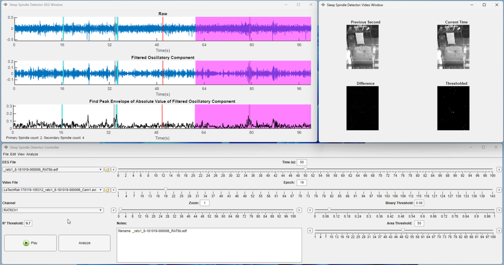

# Rodent Sleep Spindle Detector

[](https://matlab.mathworks.com/open/github/v1?repo=mathworks/Rodent-Sleep-Spindle-Detector)
[](https://www.mathworks.com/matlabcentral/fileexchange/155347-rodent-sleep-spindle-detector)

Identify candidate sleep spindles in rodent intracranial EEG (iEEG) recordings
using a multi-window MATLAB app. Inspect EEG, compare two spindle
classifications, and optionally use synchronized video to restrict detections
to periods of quiescence. Bundled simulated recordings and ground-truth
labels provide a starting point for exploring the detector.



*Published app interface, Figure 6 from Holly et al.,
[Automated rodent sleep spindle detector: MATLAB app using two complementary search algorithms](https://doi.org/10.21203/rs.3.rs-3523866/v1)
(2023). Reproduced without modification under
[CC BY 4.0](https://creativecommons.org/licenses/by/4.0/).
[View the publication figures on ResearchGate](https://www.researchgate.net/publication/375482237_Automated_rodent_sleep_spindle_detector_MATLAB_app_using_two_complementary_search_algorithms/figures).*

## Features

- **EEG inspection:** Load EDF recordings, select a channel, and navigate
  epochs with time and zoom controls.
- **Spindle detection:** Separate oscillatory activity with McSleep, filter
  it to 11–17 Hz, and compare primary and secondary classifications. The
  secondary method includes quadratic-fit rejection controlled by the
  **R² Threshold** setting.
- **Optional video analysis:** Inspect movement, crop the image, and adjust
  binary and area thresholds to identify quiescent periods.
- **Results:** Review epoch counts, event details, duration summaries, and
  sample-level classifications alongside a supplied ground truth.

## Requirements

Choose the app format for your MATLAB release:

| MATLAB release | App files |
| --- | --- |
| **R2026b or newer** | Native App Designer `.m`/`.xml` pairs in [`R2026b/`](R2026b/). Open the `.m` files in App Designer to edit the layout and callbacks. |
| **R2024a–R2026a** | Original `.mlapp` files in the repository root, saved with R2024a. |

Both versions use:

- [Signal Processing Toolbox](https://www.mathworks.com/products/signal.html)
- [Image Processing Toolbox](https://www.mathworks.com/products/image.html)
- [Curve Fitting Toolbox](https://www.mathworks.com/products/curvefitting.html)

The sample preview in `doc/GettingStarted.m` uses MATLAB and the bundled
EDF reader. Running the detector additionally requires the toolboxes above
and McSleep's `tvd` MEX function. Binaries are included for Windows x64,
Linux x64, and Intel Mac; other platforms or incompatible binaries require
a supported C++ compiler to rebuild `tvd.cpp`.

The tutorial and the original `.mlapp` app's launch and first example epoch
were checked on MATLAB R2026b on Windows. Full-recording analysis was not
part of that check.

## Setup

Download or clone the complete repository and set MATLAB's **Current Folder**
to its root. Add the app, dependencies, and icons to the path for this session:

```matlab
repoRoot = pwd;
addpath(repoRoot)
addpath(fullfile(repoRoot, 'EDF-Reader'))
addpath(fullfile(repoRoot, 'mcsleep-master'))
addpath(fullfile(repoRoot, 'Sleep Spindle Detector Alpha_resources'))
```

Then follow the instructions for your MATLAB release. Keep the shared
dependency and resource folders in place; the `R2026b` folder uses them too.

### MATLAB R2026b or Newer

Set the Current Folder to `R2026b`, add that folder to the path, and launch
the native App Designer app:

```matlab
cd(fullfile(repoRoot, 'R2026b'))
addpath(pwd)
app = SleepSpindleDetector;
app.EpochSlider.Value = 1;
app.EpochEditField.Value = 1;
```

Keep each `.m` file with its matching `.xml` file. All five app pairs are
needed for the controller, EEG, video, results, and crop windows. To edit
the app visually, open [`R2026b/SleepSpindleDetector.m`](R2026b/SleepSpindleDetector.m)
in **App Designer**; its companion XML stores the component layout.

Launch from `R2026b`: the repository root contains same-name `.mlapp` files
that take precedence when the root is MATLAB's Current Folder. Keep the
root on the path for shared helpers, and check the selected entry point with
`which SleepSpindleDetector -all`. Close the apps and restart MATLAB before
switching formats to avoid reusing a previously loaded class. Edits to one
format do not update the other.

### MATLAB R2024a–R2026a

Use the original app in the repository root and select the first epoch
before loading a recording:

```matlab
cd(repoRoot)
app = SleepSpindleDetector;
app.EpochSlider.Value = 1;
app.EpochEditField.Value = 1;
```

You can also open `SleepSpindleDetector.mlapp` in App Designer and click
**Run**. For either format, keep `app` in the workspace to export results
after analysis. The source checkout runs directly; no `.mlappinstall`
installer is included.

## Getting Started

After setup, open or run the sectioned [GettingStarted.m](doc/GettingStarted.m)
tutorial using the repository path established above:

```matlab
open(fullfile(repoRoot, 'doc', 'GettingStarted.m'))
run(fullfile(repoRoot, 'doc', 'GettingStarted.m'))
```

The tutorial sets up paths, previews the first 30 seconds of a bundled EDF,
plots the EEG with its known spindle labels, and lists four labeled intervals.
It runs without dialogs or output files. For the R2026b workflow, leave
`launchApp = false` in the tutorial and launch the app with the version-specific
commands above. The tutorial's optional `launchApp = true` setting uses the
original app's path setup.

### Try the Bundled Recording

Use these matching files in `Simulated Signals/Artificial Spindles/`:

- EEG: `20220926_simulated_artificial_signal_freq_15_dur_1_Amp_1.edf`
- Labels: `20220926_simulated_artificial_signal_freq_15_dur_1_Amp_1_AnswerKey_GroundTruth.mat`

The example has one channel, **ChannelFake**, sampled at **2,034 Hz** for
**10,000 seconds**. Its artificial spindles have a nominal frequency of 15 Hz
and duration of 1 second. Other examples vary frequency, duration, and
amplitude; `Simulated Signals/Real Spindles/` contains simulations using
recorded spindle waveforms.

1. Launch the app with the setup commands for your MATLAB release above.
2. Choose **File > Load EEG** (or the folder button beside **EEG File**) and
   select the example EDF. Loading also processes the selected preview epoch.
3. Select **ChannelFake** in **Channel**. Use **Epoch**, **Time (s)**, and
   **Zoom** to inspect the signal. Each epoch spans 100 seconds.
4. Review **R² Threshold** for the secondary classification. Start with its
   default value of `0.7` while learning the controls.
5. Click **Analyze** or choose **File > Analyze**. This processes all complete
   100-second epochs for the selected channel. The full example takes longer
   to analyze than the tutorial preview.
6. Inspect **Summary**, **Sleep Sleep Specifics**, and **Validation** in the
   results window. These are the tab names currently shown in the app.

**Analyze fills the results window; export is a separate step.** See
[Results and Export](#results-and-export).

### Prepare Your Own Recordings

| Input | Preparation |
| --- | --- |
| EEG | Use an EDF with channel labels and sampling rates in its header. The current epoch slider needs at least two complete 100-second epochs. Set the starting epoch to 1 before loading. |
| Video (optional) | Use a recording supported by MATLAB `VideoReader` on your platform, such as AVI. Align its start and duration with the EEG and verify the frame rate. The current loader does not implement multi-TIFF import. |
| Ground truth (optional) | Supply a MAT file containing `GroundTruth`, a binary vector with one label per analyzed EEG sample: 1 for spindle, 0 otherwise. Match the selected channel, sample rate, and analyzed duration. |

For video, choose **File > Load Video**, use **Edit > Crop Image** as needed,
and adjust **Binary Threshold** and **Area Threshold** while inspecting
movement. These settings control video segmentation; **R² Threshold**
controls the secondary EEG classification. Verify the video's frame rate
before pairing it with the EEG.

### Compare with Ground Truth

After analysis, open the **Validation** tab, click **Load Ground Truth**,
choose the matching `_AnswerKey_GroundTruth.mat`, then click **Caculate**
(the current button label). **Plot Ground Truth** displays the reference labels.

The loader currently resolves the MAT file by name, so put its folder on the
MATLAB path before loading. The tutorial does this for the example:

```matlab
addpath(fullfile(repoRoot, 'Simulated Signals', 'Artificial Spindles'))
```

`Tracking_stats.mlx` currently interchanges false-positive and false-negative
counts. Its displayed sensitivity and specificity therefore need to be
recomputed independently before use. The supplied labels remain useful for
visual comparison and independent validation.

## Results and Export

After **Analyze** completes, the controller exposes these workspace results:

| Property | Contents |
| --- | --- |
| `app.t` | Per-epoch primary/secondary spindle counts, spindle percentages, and quiescent percentage. |
| `app.t2`, `app.t3` | Primary and secondary event details, including epoch positions, amplitudes, and durations. |
| `app.t4`, `app.t5` | Primary and secondary mean, standard deviation, and median duration summaries. |
| `app.Primary_SS`, `app.Secondary_SS` | Sample-level classifications for the analyzed interval. Video analysis can introduce `NaN` values at epoch boundaries. |

To save CSV tables, choose an output folder and run these commands while the
app is still open. Reusing the same filenames replaces previous exports.

```matlab
outputFolder = fullfile(repoRoot, 'results');
if ~isfolder(outputFolder)
    mkdir(outputFolder)
end
writetable(app.t, fullfile(outputFolder, 'epoch_summary.csv'))
writetable(app.t2, fullfile(outputFolder, 'primary_spindles.csv'))
writetable(app.t3, fullfile(outputFolder, 'secondary_spindles.csv'))
writetable(app.t4, fullfile(outputFolder, 'primary_durations.csv'))
writetable(app.t5, fullfile(outputFolder, 'secondary_durations.csv'))
```

The results window's save menus are incomplete. **Save as... > All** targets
the validation statistics table and has a filename/folder handling error;
use the workspace exports above for detection tables.

The current event-table `time` calculation also adds an extra 100-second
epoch. For timing relative to the recording start, derive intervals from
the sample-level classifications and EDF sample rate, as the tutorial demonstrates
for the ground-truth labels.

## Troubleshooting

| Symptom | What to check |
| --- | --- |
| App, helper function, or icon is missing | Run all setup path commands and preserve the dependency/resource folders. The entry point is `SleepSpindleDetector`. |
| The original app opens instead of the R2026b version | Set the Current Folder to `R2026b`, keep the `.m`/`.xml` pairs together, and check `which SleepSpindleDetector -all`. Restart MATLAB when switching formats. |
| Error while loading a short EDF | The app initially selects epoch 21. Select epoch 1 with the setup commands before loading, and provide at least two complete 100-second epochs. |
| Recording tail is absent from results | Analysis omits the trailing partial 100-second epoch. Align validation labels to the analyzed interval. |
| `tvd` is missing or reports an invalid MEX file | Check `which tvd` and `mexext`, then rebuild for your platform if needed using the commands below. |
| Ground-truth file cannot be found or lengths differ | Add its folder to the MATLAB path and verify the `GroundTruth` variable and sample count. |
| Video does not open | Check codec support with `VideoReader` on your MATLAB installation and verify the selected filename. |

If a compatible `tvd` binary is unavailable, configure a supported compiler
and build the included source:

```matlab
mex -setup C++
mex('-outdir', fullfile(repoRoot, 'mcsleep-master'), ...
    fullfile(repoRoot, 'mcsleep-master', 'tvd.cpp'))
```

## Included Files

| File or folder | Purpose |
| --- | --- |
| `SleepSpindleDetector.mlapp` | Main controller and detection workflow. |
| `SleepSpindleDetector_EEGWindow.mlapp` | EEG visualization window. |
| `SleepSpindleDetector_VideoWindow.mlapp`, `VideoCropper.mlapp` | Video visualization and crop controls. |
| `SleepSpindleDetector_Results.mlapp` | Detection summaries and validation interface. |
| `R2026b/` | Five native App Designer `.m`/`.xml` app pairs for MATLAB R2026b or newer. |
| `doc/GettingStarted.m` | Runnable sample preview and guided app workflow. |
| `images/sleep-spindle-detector-publication.png` | Published app screenshot (Figure 6), credited above under CC BY 4.0. |
| `Simulated Signals/` | Artificial and recorded-waveform simulations with answer keys. |
| `Simulated_Sleep_Spindle_Recording_Generator.mlx` | Recording-generation example. |
| `EDF-Reader/`, `mcsleep-master/` | Bundled EDF reader and McSleep implementation. |
| `Downhill.mlx`, `Downhill_secondary.mlx`, `createFit.m`, `Tracking_stats.mlx`, `sef.m` | Detection, fitting, and statistics helpers. |
| `Sleep Spindle Detector Alpha_resources/` | App icons and other image resources. |

## Acknowledgments and License

The app is distributed under the [BSD 3-Clause license](license.txt).
Bundled dependencies retain their own licenses and source notices:
[EDF-Reader](EDF-Reader/LICENSE) and [McSleep](mcsleep-master/LICENSE).

For academic use of McSleep, cite:

Parekh A, Selesnick IW, Osorio RS, Varga AW, Rapoport DM, Ayappa I.
*Multichannel Sleep Spindle Detection using Sparse Low-Rank Optimization.*
Journal of Neuroscience Methods, 288:1–16, 2017.
[doi:10.1016/j.jneumeth.2017.06.004](https://doi.org/10.1016/j.jneumeth.2017.06.004).
See the [bundled McSleep documentation](mcsleep-master/README.md).

## Support

For bugs or feature requests, open a
[repository issue](https://github.com/mathworks/Rodent-Sleep-Spindle-Detector/issues)
with your MATLAB release, installed toolboxes, reproduction steps, and error
message. General MATLAB questions can go to
[MATLAB Central](https://www.mathworks.com/matlabcentral). See
[SECURITY.md](SECURITY.md) for reporting security vulnerabilities.

Copyright 2022-2026 The MathWorks, Inc.
